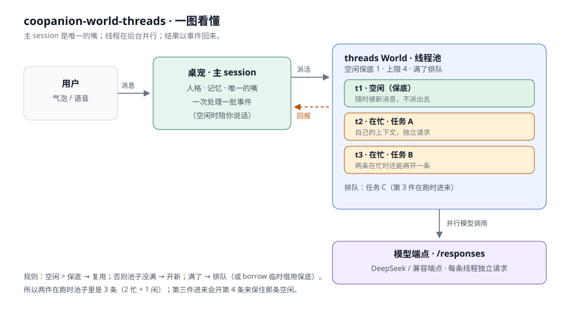

# 多线程 · coopanion-world-threads

[](https://github.com/ZhuJi-255215189/coopanion-world-threads/actions/workflows/ci.yml)
[](LICENSE)

> **Threads for Coopanion** — parallel background lanes for the desktop pet, with an always-idle spare. A Cortico World extension (API 6). 中文说明为主，见下。



给 Coopanion 桌宠一套并行的后台线程：一条在干活时，另一条还能顺便接话；同时有两件事在跑时自动开第三条；池子**始终至少留一条空闲线程**接新消息。

- 扩展类型：Cortico World（`kind: "world"`，API 6）
- 依赖：Coopanion 0.2.x（本机在 0.2.18 上验证）
- 不改 Core、不改 Persona、不改桌面宠物 World；装/卸都不动应用文件
- 自带一块实时线程池面板

## 它解决什么

Cortico 的桌宠只有一个「主 session」：主循环一次处理一批事件，长任务（写东西、整理、比较、想方案）会把这条唯一的思路占住，期间对方插一句话，就只能打断或等。

这个扩展把这类活交给**后台线程**：每条线程有自己的上下文、自己的模型调用，彼此并行；干完活把结果作为一条事件交回主 session，桌宠再用自己的口吻说出来。主 session 于是能一直空着陪人说话。

池子的规则见 [DESIGN.md](DESIGN.md)：空闲保底 1 条，两条在忙时开第三条，忙到上限才排队。

## 安装

0. 拿到代码：下载 [Release zip](https://github.com/ZhuJi-255215189/coopanion-world-threads/releases)（推荐），或：

   ```powershell
   git clone https://github.com/ZhuJi-255215189/coopanion-world-threads.git
   cd coopanion-world-threads
   ```

1. 退出 Coopanion（安装本身不依赖退出，但重启后才会加载新扩展）。
2. 在本目录运行：

   ```powershell
   powershell -ExecutionPolicy Bypass -File scripts/install.ps1
   ```

   脚本会自动找 `data\extensions`（先看 `CORTICO_EXTENSIONS_DIR`，再看 `%LOCALAPPDATA%\Coopanion\data-location.json`），把包放进 `.local\coopanion-world-threads` 并复制到 `node_modules\`，再把依赖写进 `extensions\package.json`。
   也可以显式指定：

   ```powershell
   powershell -ExecutionPolicy Bypass -File scripts/install.ps1 -ExtensionsDir "D:\Coopanion-Setup-0.2.8\data\extensions"
   ```

3. 重启 Coopanion。
4. 打开设置 →「扩展」/「World」页，找到 **多线程**，点开启。
   想让它默认开着，也可以在部署的 `config.json` 里加：

   ```json
   { "worlds": { "threads": { "enabled": true } } }
   ```

   然后重启。

> 说明：依赖写成 `file:./.local/coopanion-world-threads`，包本体在 `.local/`，同时复制一份到 `node_modules/` 供当前装载器读取；以后在 `extensions` 目录跑 `pnpm install` 也能解析到它。更新时重新执行本脚本即可。

## 用起来是什么样

- 「帮我想三个生日礼物点子，预算三百以内」→ 桌宠把这件事交给一条线程，继续说「好，我想想」；它仍然可以陪你聊别的。
- 两件事同时在跑时，你说第三件 → 自动开第三条线程；池子仍然留一条空闲的。
- 你插一句「她喜欢猫」→ 桌宠把这句话转给正在想礼物的那条线程（`thread_tell`），不打断它手头这一轮。
- 线程干完 → 桌宠收到一条回报，用自己的话说结果；失败也会说清楚卡在哪。

线程没有文件/电脑工具：要它整理一份资料，桌宠会（或你说一句让它）先把关键内容读出来、摘进任务里；真正的读写与操作电脑仍由桌宠自己的工具做。

面板里能看到每条线程在忙什么、忙了多久、最近一句、排队的活，以及保底那条空闲线程还在不在。

## 配置

设置 → 多线程（`worlds.threads`），全部热更新：

| 键 | 默认 | 说明 |
|---|---|---|
| `maxThreads` | 4 | 线程总数上限（含空闲），最多 8 |
| `reserveIdle` | 1 | 空闲保底；会被压到 `maxThreads − 1` |
| `onFull` | `queue` | 满了排队；`borrow` 临时借用保底那条 |
| `historyTurns` | 8 | 每条线程带几轮上下文 |
| `maxTokens` | 2048 | 单次回复上限 |
| `temperature` | 0.8 | 线程的温度 |
| `timeoutSec` | 120 | 单次模型调用超时 |
| `endpoint` / `model` / `apiKeyEnv` | 空 | 留空＝跟随当前激活的 provider；也可给线程单独接一个更便宜的端点 |

线程的用量会通过 `reportUsage` 记进 Coopanion 的 usage 账本（标签 `线程 tN`），预算/用量类扩展能看到。

## 边界

- **线程不能操作电脑**：看屏幕、点鼠标、敲键盘仍然只能由主 session 的 `pet_cua_*` 工具做。线程适合「想、查、写、整理」，不适合「动手」。
- **端点**：默认跟随当前 provider（API Key 型）。没有 secret 的本机端点（如 llamacpp）也能用，不带鉴权；ChatGPT 登录型（OAuth）端点不走这条 HTTP 路径，会提示读不到密钥。
- **每条线程单独计费**：并发越多，单位时间的 token 越多。`maxThreads` 是花钱的上限。
- **不是操作系统线程**：是同一进程里的并发 async 调用；模型请求在网络上并行，CPU 侧仍然是单线程事件循环。
- **重启会中断运行中的线程**：历史保留，但手头的任务不会自动重跑；回报里会说明失败。
- **线程只看得到人格摘录**：`CONSTITUTION.md` 与 `PARTNER.md` 的前 2600 字，加上自己的对话历史；看不到主 session 的完整上下文。这是刻意的——否则每条线程都会很贵，也会让它们以为自己知道得比实际多。

> 想让「严格 2 件在跑 + 1 条空闲」而不是默认的 3 + 1，把 `maxThreads` 调到 3 即可；第 3 件会排队等空位。

## 本地校验

单元测试（调度器与线程状态机，不联网）：

```powershell
cd coopanion-world-threads
node --experimental-strip-types --test test/pool.test.mjs test/thread.test.mjs test/model.test.mjs
```

dry-mount（用 Cortico 自带的检查器构造 World、查工具与面板声明；先切到应用目录，`--import tsx` 才解析得到）：

```powershell
$App  = 'D:\Coopanion-Setup-0.2.8\resources\app'   # 换成你的安装目录
$Exe  = 'D:\Coopanion-Setup-0.2.8\Coopanion.exe'   # 换成你的可执行文件
$Repo = 'C:\path\to\coopanion-world-threads'       # 换成仓库目录
cd $App
$env:ELECTRON_RUN_AS_NODE = '1'
$env:COOPANION_APP = $App
& $Exe --import tsx --import "file:///$($App -replace '\\','/')/build/cortico/src/extensions/runtime.ts" "$Repo\scripts\verify.mjs"
```

端到端（起一个假的 `/responses` 端点，验证派活、排队、回报、插话、存档，不花 token；同样在应用目录下跑）：

```powershell
& $Exe --import tsx --import "file:///$($App -replace '\\','/')/build/cortico/src/extensions/runtime.ts" "$Repo\scripts\e2e.mjs"
```

## 目录

```
src/pool.ts        纯调度器：空闲保底、复用/新开/排队/借用
src/thread.ts      一条线程：历史、inbox、插话排队、失败
src/model.ts       端点解析 + Responses/Chat 调用 + 用量
src/world.ts       World：工具、事件、面板、存档、人格摘录
src/config.ts      配置段与默认值
src/ENV_PROMPT.md  写进前缀的使用规则
dist/webui/client.js  线程池面板（纯 ESM，无构建）
```

## 许可

MIT（代码）。`describe.json` 与 `ENV_PROMPT.md` 是同一份 MIT。
